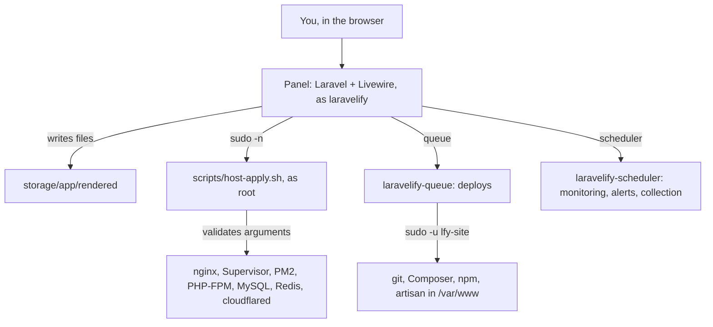

Laravelify is a normal Laravel app running on the server it manages. It never runs as root. Every system change goes through one script.

## The panel

- Runs as its own user, `laravelify`, in its own PHP-FPM pool, in `/opt/laravelify`. Each website runs as `lfy-<slug>` (or `www-data` until it is moved) and cannot read the panel. See [Users and permissions](/security/privilege-separation).
- Stores its own data in MySQL (database `laravelify`). Secrets (tokens, passwords, keys) are encrypted with the app key.
- Keeps its sessions, queue, and cache in MySQL too (not in Redis, which every site can reach).

## host-apply.sh

The panel prepares every config file in `storage/app/rendered`, then asks `scripts/host-apply.sh` to install it. A sudoers rule allows the panel's user to run that one script as root, and nothing else.

The script:

- accepts a fixed list of actions (`site`, `site-nginx`, `cloudflared`, `php-fpm`, `supervisor`, `pm2`, …);
- validates every argument (site slugs, versions, program names) before using it as a path;
- checks every nginx, Supervisor, and PHP-FPM file it installs (log paths, includes, the user programs run as), and never writes as root through a path inside a site folder;
- runs `nginx -t` before every nginx reload, so a broken file is reported instead of taking sites down.

In a website, terminal commands run as that website's user (`lfy-<slug>`) inside a `systemd-run` sandbox (read-only system, private `/tmp`, no new privileges, 60-second limit). Deploy commands and file manager changes run as the same user through `sudo -u`, because they run or touch the site's own code. At `/var/www` itself the terminal runs as `nobody` and cannot see inside the sites.

## Background workers

| Supervisor program | Does |
| --- | --- |
| `laravelify-queue` | Runs deploys one after another, with live logs |
| `laravelify-scheduler` | Every minute: uptime checks, request and error collection, server samples, heartbeats, alerts. Daily: pruning, server patch check |

## Websites

| Type | Served by | Kept running by |
| --- | --- | --- |
| Laravel | nginx → PHP-FPM socket of the site's PHP version | Supervisor (`queue:work`, `schedule:work`, optional Reverb, your own programs) |
| PHP | nginx → PHP-FPM socket | PHP-FPM only |
| Express, NestJS, Node.js, Next.js, Nuxt, SvelteKit | nginx → `127.0.0.1:{port}` | PM2 (the start command, or Next.js's standalone server) |
| React, Vue.js, Angular, Svelte, Astro, Static HTML | nginx serves the built files | nothing: there is no process |

See [Frameworks](/websites/frameworks).

Traffic reaches nginx through a Cloudflare tunnel (`cloudflared` → `http://127.0.0.1:80`), and nginx picks the site by `server_name`.
