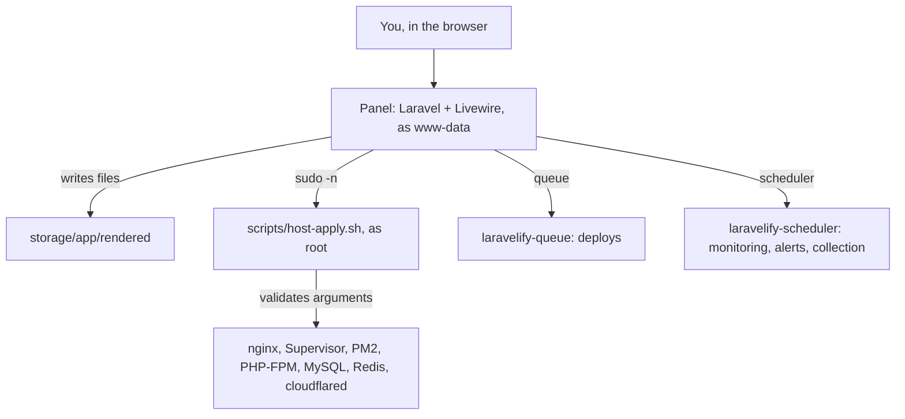

Laravelify is a normal Laravel app running on the server it manages. It never runs as root. Every system change goes through one script.

## The panel

- Runs as `www-data` under nginx and PHP-FPM, in `/opt/laravelify`.
- Stores its own data in MySQL (database `laravelify`). Secrets (tokens, passwords, keys) are encrypted with the app key.
- Uses Redis for sessions and queues.

## host-apply.sh

The panel prepares every config file in `storage/app/rendered`, then asks `scripts/host-apply.sh` to install it. A sudoers rule allows `www-data` to run that one script as root, and nothing else.

The script:

- accepts a fixed list of actions (`site`, `site-nginx`, `cloudflared`, `php-fpm`, `supervisor`, `pm2`, …);
- validates every argument (site slugs, versions, program names) before using it as a path;
- runs `nginx -t` before every nginx reload, so a broken file is reported instead of taking sites down.

Commands from the terminal and the deploy run as `www-data` inside a `systemd-run` sandbox (read-only system, private `/tmp`, no new privileges, 60-second limit for the terminal).

## Background workers

| Supervisor program | Does |
| --- | --- |
| `laravelify-queue` | Runs deploys one after another, with live logs |
| `laravelify-scheduler` | Every minute: uptime checks, request and error collection, server samples, heartbeats, alerts. Daily: pruning, server patch check |

## Websites

| Type | Served by | Kept running by |
| --- | --- | --- |
| Laravel | nginx → PHP-FPM socket of the site's PHP version | Supervisor (`queue:work`, `schedule:work`, optional Reverb, your own programs) |
| Next.js | nginx → `127.0.0.1:{port}` | PM2 (`.next/standalone/server.js`) |

Traffic reaches nginx through a Cloudflare tunnel (`cloudflared` → `http://127.0.0.1:80`), and nginx picks the site by `server_name`.
