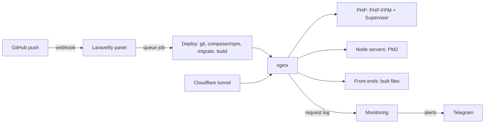

Laravelify is an open-source control panel that turns one Ubuntu server into a home for your apps: **Laravel** and PHP backends, **Express**, **NestJS**, and other Node.js servers, **React**, **Vue.js**, **Angular**, **Svelte**, and **Astro** front ends, and full-stack **Next.js**, **Nuxt**, and **SvelteKit**. Push to GitHub and your site deploys. Open the panel and you see live traffic, errors, attacks, and server load. It runs on your hardware, with no per-seat pricing and no vendor in the middle.

It is built with the same stack as the apps it hosts (Laravel, Livewire, Alpine, and Tailwind) and follows the design of [Coolify](https://coolify.io). Unlike Coolify it does **not** use Docker: PHP sites run on nginx and PHP-FPM (Laravel with Supervisor workers), Node servers run under PM2, and front-end builds are served as files by nginx.

<Note>
  Laravelify is **self-hosted only**. There is no cloud version: you install it on your own server with one command, and everything stays there.
</Note>

## What you get

<CardGroup cols={2}>
  <Card title="Git push to deploy" icon="rocket" href="/websites/github">
    GitHub App or token, webhooks, full build logs, one-click redeploys.
  </Card>
  <Card title="Backend, frontend, full-stack" icon="layer-group" href="/websites/frameworks">
    PHP 8.0–8.5, Node 20–24 servers under PM2, and React, Vue, Angular, Svelte, and Astro builds served by nginx.
  </Card>
  <Card title="Live monitoring" icon="chart-line" href="/monitoring/overview">
    Requests, response times, uptime, grouped Laravel errors, and a live request feed.
  </Card>
  <Card title="Attack detection" icon="shield-halved" href="/security/site-security">
    SQL injection, XSS, scanners, and attack tools flagged, with one-click IP blocking.
  </Card>
  <Card title="Telegram alerts" icon="telegram" href="/monitoring/telegram">
    Deploys, downtime, crashed workers, error spikes, slow responses, missed cron jobs.
  </Card>
  <Card title="Cloudflare tunnels" icon="cloud" href="/websites/cloudflare-tunnels">
    No open ports needed: HTTPS terminates at Cloudflare, the server stays private.
  </Card>
  <Card title="Server tools" icon="terminal" href="/tools/file-manager-and-terminal">
    File manager, terminal with Laravel/PM2 autocomplete, logs, health checks, phpMyAdmin sign-in.
  </Card>
  <Card title="Server monitoring" icon="microchip" href="/monitoring/server">
    Live CPU, memory, load, network, services, and top processes.
  </Card>
</CardGroup>

## How it fits together

## Next steps

<CardGroup cols={2}>
  <Card title="Quickstart" icon="bolt" href="/quickstart">
    Install the panel and deploy your first site in about ten minutes.
  </Card>
  <Card title="Server requirements" icon="server" href="/installation/requirements">
    What the server needs before you run the installer.
  </Card>
</CardGroup>
